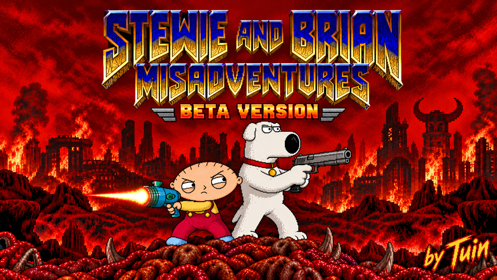

# Stewie & Brian: Misadventures

Take Stewie and Brian into Doom with a custom arsenal, throwable gadgets, companion support and outrageous inventions.

**By Tuin · Beta v0.233 · Single-player gameplay mod**

## Download

[Download beta v0.233 — PK3 (approximately 525 MB)](https://github.com/tuin-boop/Stewie-Brian-Misadventures/releases/download/v0.233/Stewie-Brian-Arsenal-v0.233.pk3)

The playable mod is attached to the release. GitHub's **Code → Download ZIP** downloads this project page, not the playable PK3.

## Installation

1. Install **UZDoom 4.14.3** and provide your own **Doom II IWAD** (`doom2.wad`). Neither is included.
2. Download `Stewie-Brian-Arsenal-v0.233.pk3` from the release. **Do not extract the PK3.**
3. Drag it onto `uzdoom.exe`, or add it to your Doom launcher and select Doom II.
4. Start a **new game**, choose Stewie or Brian, and follow or skip the introductory tutorial.

Custom map WADs can be loaded before the mod. Compatibility with other weapon/player replacement mods is not guaranteed. Load only one version of this mod at a time. The main PK3 works on its own; separate optional add-ons are not included in this release.

Press **F1** for the mod's development story and beta information. Replay the tutorial through the mod settings' **Tutorial** tab. Check the engine's control settings and tutorial for your current bindings.

## Features

- Play as Stewie or Brian and switch characters.
- Custom weapons, sprites, animations and alternate attacks.
- Companion support with weapon selection and follow/hold-position orders.
- Weapon and device selection wheels.
- Throwable shields and black holes with landing previews.
- Special abilities, time manipulation and bomber flight.
- A handheld map tablet, custom HUD and illustrated tutorial.

## Beta / work in progress

Expect bugs, unfinished details and changes to artwork, balance and compatibility. Start a new game when updating; older saves are not a reliable way to test a new build.

For bug reports, include your mod version, engine version, map/WAD, complete load order, reproduction steps and a screenshot if useful.

v0.233 removes 34 obsolete artwork files, reducing the package by about 17.7 MB. It retains the illustrated tutorial and F1 about page from the preceding builds.

## Development and credits

Built through Tuin's creative direction, art references, screenshots and hands-on playtesting, with ChatGPT/Codex assistance for coding, debugging and asset integration.

This is an unofficial fan project. Family Guy, Doom and third-party contributions belong to their respective rights holders. It is not affiliated with or endorsed by them.

Credits and notices are inside the PK3: `COMPANION-CREDITS.txt`, `FONT-SOURCE.txt`, `CREDITS-NUKE.txt`, `tablet-minimap-LICENSE.txt` and `credits/`. The in-game Tiny font is credited by Doom Delta to **Jimmy**.

No blanket open-source or asset-reuse licence is granted by this repository. Third-party terms remain applicable; some asset permissions remain unverified. Included credits identify sources but are not a substitute for permission.
